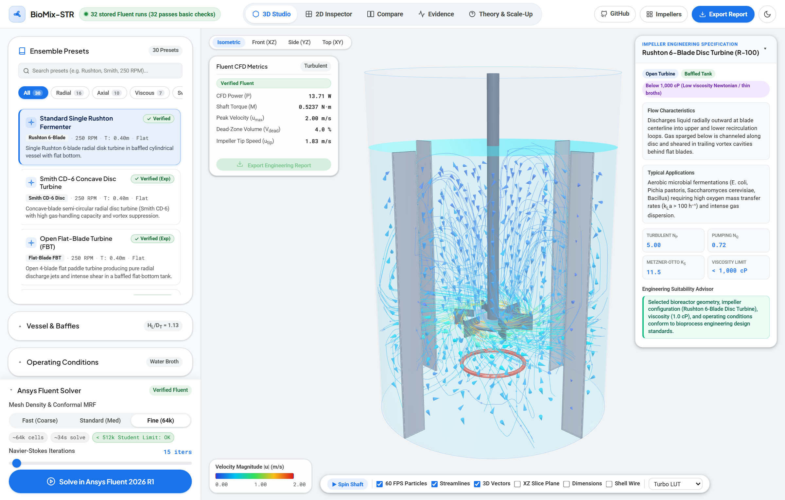
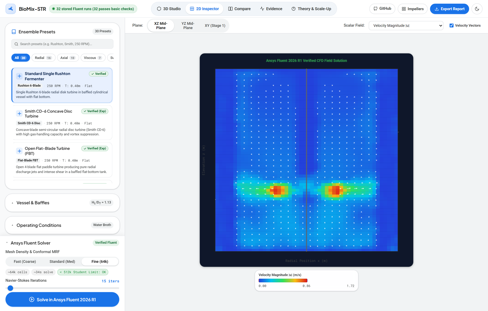
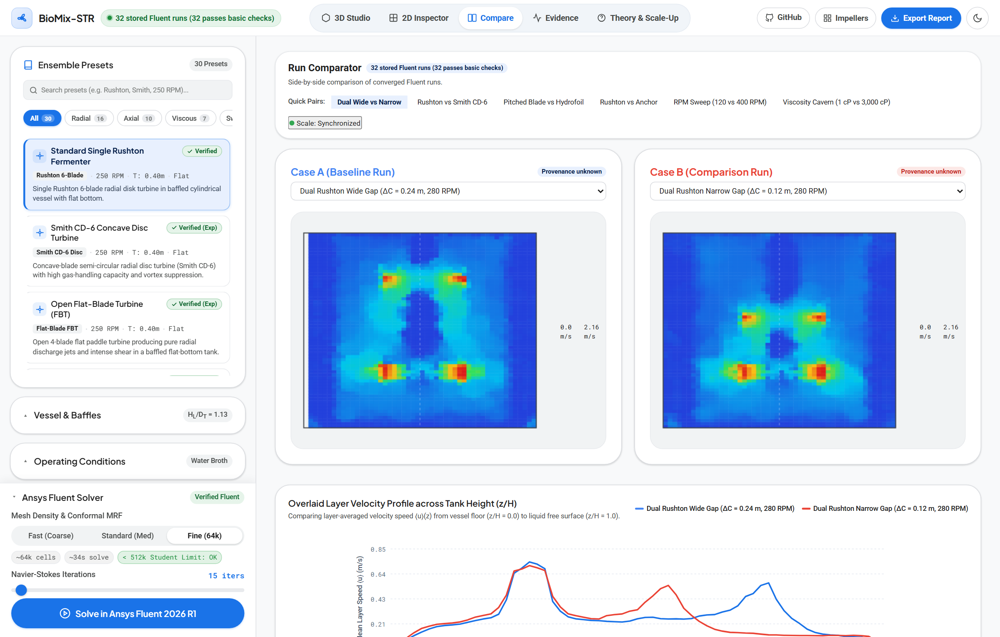
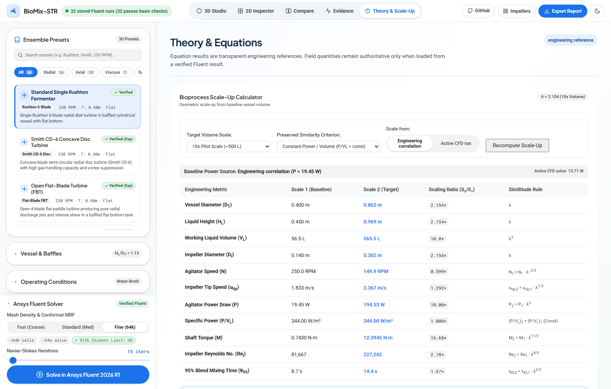
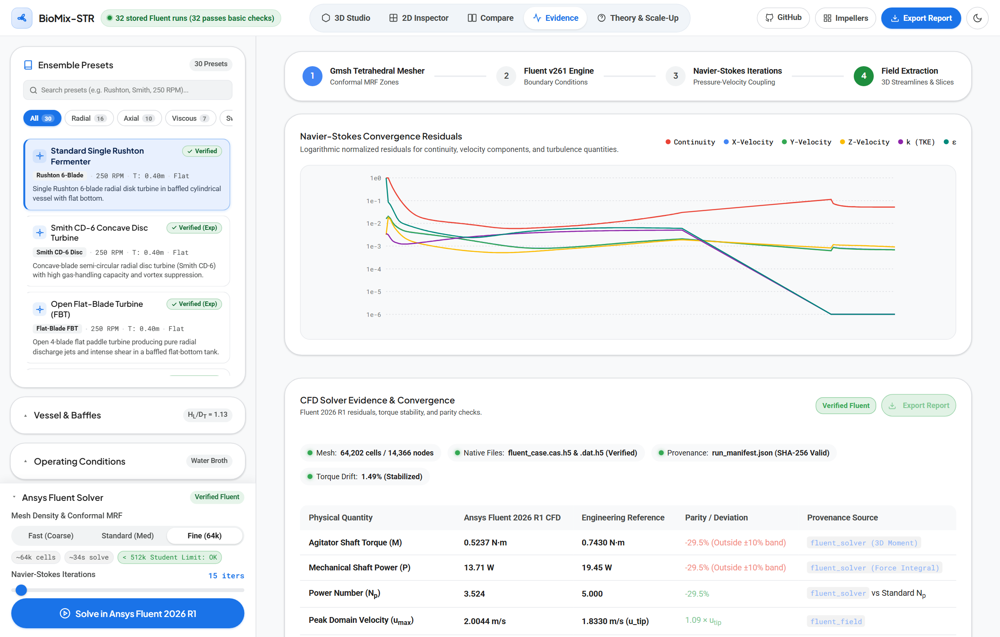
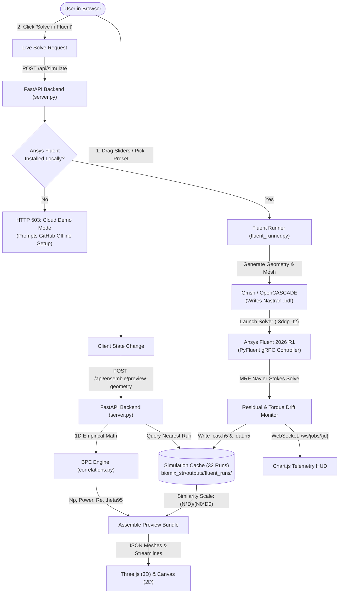

<div align="center">

# BioMix-STR

[](https://python.org)
[](https://fastapi.tiangolo.com)
[](LICENSE)
[](https://biomix-str.onrender.com)

**A web-based 3D studio to inspect stirred-tank bioreactor hydrodynamics, check empirical bioprocess numbers, and run automated Ansys Fluent CFD.**

[Live Demo](https://biomix-str.onrender.com) • [Why I Built This](#why-i-built-this) • [Visual Tour](#visual-tour) • [How It Works](#how-it-works) • [Benchmarks](#verified-cfd-benchmarks) • [Quickstart](#quickstart) • [What Works / What's Next](#what-actually-works-today)

</div>

---

## Why I Built This

Designing a stirred-tank bioreactor usually leaves you with two bad options:

1. **Textbook hand calculations:** You plug numbers into empirical formulas (Doran, Paul, Ruszkowski) in Excel. You get a single average power number and a nominal mixing time, but zero insight into where dead zones form, where shear peaks near blade tips, or how the flow actually circulates.
2. **Manual industrial CFD:** You open CAD, spend hours sketching baffles and impeller blades, mesh the domain in Gmsh or Fluent Meshing, set up rotating frames, wait for iterations to converge, and pull slice planes. Repeating this for every geometry tweak is slow and painful.

I built BioMix-STR to bridge this gap. You pick tank dimensions, dish heads, and impellers from sliders or presets, get instant empirical numbers alongside a 3D WebGL preview, and can trigger real 3D Ansys Fluent solves without touching the Fluent GUI.

---

## Visual Tour

### 1. 3D WebGL Studio
Interactive 3D viewport rendering vessel shells, dish bottoms (Flat, ASME 2:1, Hemispherical), baffles, rotating impellers, and 3D velocity streamlines integrated via 4th-order Runge-Kutta.



### 2. 2D Cut-Plane Field Inspector
Bilinear interpolation on vertical ($XZ$, $YZ$) and horizontal cut planes showing velocity magnitude, static pressure, turbulent kinetic energy ($k$), dissipation rate ($\varepsilon$), and Kolmogorov microscale length ($\lambda_K$).



### 3. Run Comparator
Side-by-side comparison of converged CFD simulation runs, showing differential metrics, power consumption deltas, and flow profile comparisons.



### 4. Hydrodynamic Scale-Up Engine
Side-by-side 5-criterion scale-up similitude ($P/V$, $u_{\text{tip}}$, $Re$, $\theta_{95}$, $k_L a$) comparing small-scale seed fermenters to production vessels.



### 5. Live Solver Convergence & Evidence
Real-time residual decay tracking (continuity, velocities $u, v, w$, turbulence $k, \varepsilon$) and sliding-window torque drift stability monitor.



---

## How It Works



### Dual-Mode Execution

* **Cloud Demo Mode:** Deployable anywhere on Linux or Docker (live at [biomix-str.onrender.com](https://biomix-str.onrender.com)). It includes **32 pre-computed, converged Ansys Fluent simulation runs** saved as binary case/data and JSON bundles. When you scrub sliders away from a preset, it calculates 1D bioprocess formulas in real time and similarity-scales the nearest velocity field $(N\cdot D)/(N_0\cdot D_0)$ for a fast visual preview. If you click "Run Fluent", it explains that live solving requires a local Fluent installation.
* **Workstation CFD Mode:** If you have Ansys Fluent installed locally, the server uses `ansys-fluent-core` (PyFluent) to build the 3D geometry in Gmsh, export a Nastran `.bdf` mesh, launch Fluent in double precision (`-3ddp`), assign Moving Reference Frame (MRF) zones, iterate Navier-Stokes equations, and stream residual curves and torque drift back over WebSockets.

### Physics Models & Assumptions

* **Single-Phase Liquid MRF:** Fluent solves steady-state single-phase liquid flow. Baffles and tank walls are stationary, while fluid surrounding the impeller rotates at shaft speed $\omega$.
* **Aeration is 1D Empirical:** Fluent does **not** solve multiphase volume-of-fluid (VOF) or bubble dispersion. Gas holdup, flooding limit ($Fl_{\text{flood}}$), and mass transfer ($k_L a$) are computed from textbook 1D empirical correlations (Van 't Riet, Nienow).
* **Mixing Time ($\theta_{95}$):** Calculated via the Ruszkowski correlation, not a transient scalar tracer injection.
* **Visual Streamlines vs Particles:** Streamlines are traced using RK4 integration through the 3D velocity field. The glowing moving dots are a Three.js WebGL visual effect along those lines, not physical discrete-phase particles (DPM).

---

## Verified CFD Benchmarks

The repository includes 32 pre-computed, converged Ansys Fluent 2026 R1 datasets. Here are 8 key canonical configurations extracted directly from solver run metadata:

| Impeller Configuration | Tank Bottom | Speed | Reynolds Number | Mesh Cells | CFD Power | Empirical Ref | Torque Drift |
| :--- | :---: | :---: | :---: | :---: | :---: | :---: | :---: |
| **Rushton 6-Blade Turbine** | Flat | 250 RPM | 81,667 | 64,202 | 13.71 W | 19.45 W | 1.49% |
| **Pitched-Blade Turbine (45°)** | ASME 2:1 | 220 RPM | 93,867 | 11,552 | 4.82 W | 7.75 W | 1.93% |
| **Gentle Marine Propeller** | Hemispherical | 130 RPM | 55,467 | 8,791 | 0.26 W | 0.37 W | 1.51% |
| **Hydrofoil HE-3 Axial** | ASME 2:1 | 250 RPM | 222 | 30,811 | 2.55 W | 4.56 W | 1.06% |
| **Smith CD-6 Concave Radial** | Flat | 250 RPM | 81,667 | 14,135 | 2.99 W | 12.45 W | 0.92% |
| **Anchor Close-Clearance** | Flat | 40 RPM | 18 | 16,929 | 6.94 W | 17.38 W | 0.08% |
| **Double Helical Ribbon** | Flat | 35 RPM | 3 | 28,983 | 11.12 W | 120.28 W | 1.69% |
| **EKATO Intermig Multi-Stage** | ASME 2:1 | 150 RPM | 144,000 | 11,677 | 3.21 W | 8.09 W | 1.25% |

*Note: Rushton, PBT, Marine, Smith CD-6, and Intermig are simulated in water systems (turbulent regime); HE-3, Anchor, and Helical Ribbon are evaluated in high-viscosity non-Newtonian broths (laminar/transitional regimes).*

---

## Quickstart

### Understanding the Execution Modes

BioMix-STR operates in one of two modes:

1. **Cloud Demo Mode (Default — Zero Ansys Required):**
   * Works out of the box on Windows, Linux, macOS, or Docker.
   * Loads **32 pre-computed, converged Ansys Fluent CFD datasets** (full 3D velocity vectors, cut-plane contours, torque drift, and residual histories).
   * Runs 1D bioprocess scaling math in real time and scales 3D velocity fields via $(N\cdot D)/(N_0\cdot D_0)$ similarity for interactive design.
   * You can test it immediately without installation at **[biomix-str.onrender.com](https://biomix-str.onrender.com)**.

2. **Workstation Live CFD Mode (Requires Local Ansys Fluent):**
   * Required **only** if you want to click "Run Fluent" to generate procedural CAD meshes with Gmsh and solve 3D Navier-Stokes equations live.
   * Requires a local desktop installation of **Ansys Fluent (2024 R1, 2025 R1, or 2026 R1)**. If you do not have an Ansys license, download the free [Ansys Student Edition](https://www.ansys.com/academic/students/ansys-student) (free student license, capped at 512k cells).
   * **PyFluent Note:** The Python package `ansys-fluent-core>=0.20.0` is already included in `requirements.txt`. It acts as a gRPC bridge to your local Fluent installation. It does **not** bundle the CFD solver itself. Ensure Fluent is installed and available in your system `PATH` (or via `AWP_ROOT<ver>` environment variables).

---

### Prerequisites
* **Python:** 3.10, 3.11, or 3.12 (64-bit).
* **Git** installed on your system.
* *(Optional for live CFD)*: Desktop Ansys Fluent (2024 R1, 2025 R1, or 2026 R1).

---

### Step 1: Clone Repository & Setup Environment

Clone the repository and prepare your virtual environment:

```bash
git clone https://github.com/deep-911/biomix-str.git
cd biomix-str

# 1. Create virtual environment
python -m venv .venv

# 2. Activate virtual environment
# On Windows (cmd / PowerShell):
.venv\Scripts\activate
# On Linux / macOS:
source .venv/bin/activate

# 3. Upgrade pip and install third-party dependencies (includes PyFluent)
pip install --upgrade pip
pip install -r requirements.txt

# 4. Install BioMix package in editable development mode
pip install -e biomix_str
```

---

### Step 2: Launch BioMix Studio (Choose ONE Option)

Once Step 1 is complete, start the studio using any **one** of the following execution options:

#### Option A: Windows (1-Click Launcher)
Run the automated launcher batch script:
```cmd
run_biomix_studio.bat
```
*(Activates `.venv`, clears any stale process on port 8000, starts Uvicorn, and automatically opens `http://127.0.0.1:8000` in your browser).*

#### -- OR --

#### Option B: Linux / macOS (Shell Script)
Make executable and run the bash launcher:
```bash
chmod +x run_biomix_studio.sh
./run_biomix_studio.sh
```
*(Activates environment, configures `PYTHONPATH`, starts server, and opens default browser).*

#### -- OR --

#### Option C: Manual CLI (Cross-Platform)
Start the ASGI server directly via Uvicorn:
```bash
python -m uvicorn biomix.server:app --host 127.0.0.1 --port 8000
```
Open **[http://localhost:8000](http://localhost:8000)** in your browser.

#### -- OR --

#### Option D: Docker Compose (Local Container)
If you prefer running in an isolated container without configuring local Python:
```bash
docker compose up --build
```
Open **[http://localhost:8000](http://localhost:8000)**. Container runs in Cloud Demo Mode with full access to the 32 pre-computed CFD runs.

---

### Verification

Run the test suite to verify math correlations, geometry generation, and API routes:
```bash
pytest biomix_str/tests
```

---

## What Actually Works Today

* **16 Impeller CAD Models:** Procedural 3D geometries for Rushton, Smith CD-6, Marine Propeller, Pitched-Blade (45°), Chemineer HE-3 / Lightnin A-310 fluidfoil, Maxflo, Anchor, Double Helical Ribbon, Archimedes Auger, EKATO Intermig, Paddle R-200, Retreat Blade, and others.
* **3 Dish Bottoms:** Flat, ASME 2:1 Elliptical, and Hemispherical bottom heads with volume and clearance corrections.
* **32 Pre-computed CFD Datasets:** Full 3D velocity vectors, cut planes, torque monitors, and residual histories ready to inspect instantly without solving.
* **2D Slice Inspector:** Bilinear interpolation on $XZ$, $YZ$, and horizontal planes showing velocity magnitude, static pressure, turbulent kinetic energy ($k$), dissipation rate ($\varepsilon$), and Kolmogorov microscale length ($\lambda_K$).
* **Metzner-Otto Rheology:** Apparent viscosity calculation ($\mu_{\text{app}} = K \dot{\gamma}^{n-1}$) for shear-thinning broths.
* **Scale-Up Engine:** 5-criterion scale-up tool comparing Constant $P/V$, Constant Tip Speed, Constant $Re$, Constant Mixing Time, and Constant $k_L a$.
* **Automated Fluent Pipeline:** Launches Fluent, builds conformal meshes, monitors torque drift over sliding iterations, and writes native `.cas.h5` and `.dat.h5` files.
* **Testing:** 750+ passing pytest cases covering algebraic formulas, geometry generation, API endpoints, and provenance gates.

---

## What's Rough or Missing

* **No Multiphase CFD:** There are no gas bubbles or gas cavities solved in Fluent. Aeration metrics are 1D correlations only.
* **No Transient Mixing Tracer:** Mixing time is not calculated from a virtual dye or salt pulse in Fluent; it uses empirical formulas.
* **Mesh Coarseness on Student Licenses:** Because Ansys Student caps mesh size at 512,000 cells, baseline Rushton runs use ~64,000 cells. This underpredicts turbulent power draw ($N_p \approx 3.6$ vs literature $5.0$) due to coarse boundary layer resolution at blade tips.
* **Unbaffled Run Sensitivity:** The MRF boundary placement in unbaffled cases needs careful refinement to avoid artificial swirl torque.
* **Uniform Non-Newtonian CFD:** In Fluent, the Metzner-Otto viscosity is currently passed as a single domain-wide effective viscosity rather than a spatially varying non-Newtonian viscosity field.

---

## License

MIT
