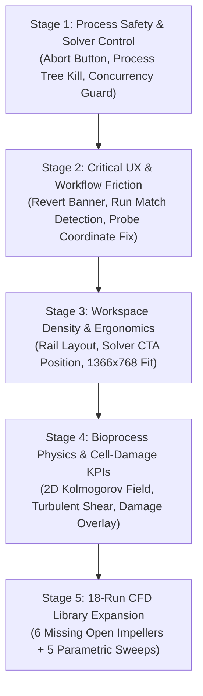

# BioMix-STR: Extreme Technical Audit & Multi-Agent Roast
**Document ID:** `AUDIT-BIOMIX-2026-PHASE-F`  
**Date:** October 18, 2026  
**Auditors:** Antigravity Multi-Agent Engineering Inspection Taskforce  
**Target Architecture:** BioMix-STR · Ansys Fluent 2026 R1 CFD Studio  

---

## Executive Summary

BioMix-STR has achieved legitimate CFD solver integration with Ansys Fluent 2026 R1, conformal tetrahedral meshing via Gmsh OpenCASCADE, and verified convergence across 9 reference bioreactor setups. However, a rigorous inspection of the human-factors workflow, runtime process management, CAD geometry representations, and bioprocess KPI delivery exposes serious design traps, operational vulnerabilities, and physics gaps that undermine its industrial utility.

This audit compiles findings across 4 distinct inspection vectors:
1. **Human-Factors & UX Workflow:** Unforgiving state degradation, coordinate projection bugs in hover tooltips, and severe vertical screen-space bloat.
2. **Operational Feasibility & Solver Safety:** Unstoppable background solver subprocesses, lack of pre-flight license/cell guards, and asynchronous race conditions.
3. **Physics, CAD & Bioprocess KPI Delivery:** Primitive rectangular box approximations for close-clearance impellers, unmeshed visual-only internals, and the omission of 2D Kolmogorov microscale and turbulent shear stress fields.
4. **CFD Reference Library Deficits:** Absence of pre-computed verified runs for 6 of the 8 experimental open impellers and a total lack of parametric operating sweeps.

---

## Part 1: UX & Workflow Roast (Human-Factors & Live Browser Audit)

### 1.1 The "Slider Touch Trap" (Abrupt State Destruction)
* **The Defect:** When viewing any of the 9 official `Verified Fluent` presets (e.g. `Rushton 6-Blade Disc (250 RPM, Fine Mesh)`), touching any slider in the left rail—such as nudging the RPM from `250` to `255` or adjusting liquid height by `0.01 m`—triggers `requestGeometryPreview()`.
* **Immediate Consequences:**
  1. `AppState.currentRunId` is immediately set to `null`.
  2. The primary HUD badge instantly flips from `✓ Verified Fluent` to `● Geometry Preview & Engineering Reference`.
  3. The `Export Engineering Report` buttons in the navbar, HUD, and evidence drawer immediately dim to `opacity: 0.5` with `cursor: not-allowed`.
  4. The 3D viewport discards the high-fidelity Fluent vector field and switches to the analytical 2D boundary extrapolation.
* **The Human-Factors Failure:** The interface provides **zero confirmation prompt**, **zero warning banner**, and **zero "Revert to Active Verified Fluent Run" button**. An engineer who spent minutes inspecting a convergence history or 3D jet has their entire CFD state erased by an accidental slider scrub, with no way to restore it other than re-finding and re-clicking the preset in the rail.

```
+-----------------------------------------------------------------------------------+
| SLIDER TOUCH TRAP FLOW:                                                           |
| [Verified Fluent Run Loaded] ---> [User nudges RPM slider +5 RPM]                  |
|                                       |                                           |
|                                       v                                           |
|                              AppState.currentRunId = null                         |
|                              HUD Badge -> "Geometry Preview"                      |
|                              Report Export -> Disabled (50% Opacity)              |
|                              Verified Field -> Erased from Viewport               |
|                                       |                                           |
|                              NO REVERT BUTTON! NO UNDO! NO WARNING!              |
+-----------------------------------------------------------------------------------+
```

### 1.2 Missing Discoverability of Existing Verified Runs
* **The Defect:** A user wanting to inspect a `Smith CD-6` or `Chemineer Hydrofoil HE-3` or `Anchor` impeller will naturally navigate to Card 5 ("Multi-Impeller Stages") and select the impeller from the dropdown menu.
* **The Failure:** The instant `select-imp1-type` changes, the system fires `requestGeometryPreview()`, displaying an analytical estimate. The app **fails to perform a pre-flight library lookup** against `outputs/fluent_runs/`. Even though complete Ansys Fluent 2026 R1 verified runs exist on disk for all three impellers (`fluent_smit_flat_250rpm_0bfbe7c7de0c`, `fluent_hydr_elli_250rpm_959ef9534ed6`, and `fluent_anch_flat_40rpm_d12f32384b94`), the user is given no indication that CFD evidence is available.
* **Impact:** Unless the user manually deciphers that Preset 7, Preset 8, or Preset 9 corresponds to their selection, they remain trapped in low-fidelity preview mode, falsely assuming Fluent has never solved that geometry.

### 1.3 2D Field Inspector & Comparator Coordinate Clipping Bug
* **The Defect:** In Tab 2 (`2D Field Inspector`), the canvas element `#canvas-2d-slice` styles the cursor as `crosshair`, suggesting full interactive probing. However, hovering the cursor over the canvas displays **nothing**.
* **The Root Cause:** In `setupSliceCanvasProbe()` ([app.js:L1345-L1347](file:///c:/Users/iPC/Downloads/Code/BioMix%20-%20STR/biomix_str/src/biomix/static/app.js#L1345-L1347)):
  ```javascript
  tooltip.style.left = `${e.clientX + 10}px`;
  tooltip.style.top = `${e.clientY + 10}px`;
  ```
  The tooltip element `#slice-tooltip` is nested inside `.slice-canvas-wrapper`, which specifies:
  ```css
  .slice-canvas-wrapper {
    position: relative;
    overflow: hidden;
  }
  #slice-tooltip {
    position: absolute;
  }
  ```
  Setting `left = e.clientX` (viewport-relative coordinate, e.g. `850px`) on an `absolute` element whose parent is `relative` positions the tooltip 850px *inside the wrapper*, throwing it completely outside the container boundaries where `overflow: hidden` clips it into invisibility.
* **Comparator Absence:** In Tab 3 (`Configuration Comparison`), side-by-side heatmaps have no probe listeners attached whatsoever, rendering both panels dead static images.

### 1.4 Screen Estate & Vertical Scrolling Excess
Live headless browser telemetry on standard display viewports reveals extreme vertical overflow in `#workbench-rail`:

| Display Resolution | Rail Client Height | Rail Scroll Height | Hidden Vertical Overflow | Screens of Scroll |
| :--- | :--- | :--- | :--- | :--- |
| **1366 x 768 (Laptop)** | **704 px** | **2,209 px** | **1,505 px** | **3.14 x Viewport Height** |
| **1920 x 1080 (Desktop)** | **1,016 px** | **2,209 px** | **1,193 px** | **2.17 x Viewport Height** |

* **Card-by-Card Footprint Breakdown:**
  1. Card 1 (`Ensemble Presets`): 283 px
  2. Card 2 (`Vessel & Baffles`): 373 px
  3. Card 3 (`Operating Conditions`): 334 px
  4. Card 4 (`Vessel Internals`): 358 px
  5. Card 5 (`Multi-Impeller Stages`): 457 px
  6. Card 6 (`Ansys Fluent Solver`): 252 px (Starts at `y = 1,957 px`!)
* **The UX Trap:** The primary conversion action of the entire application—Card 6 with the `"Solve in Ansys Fluent 2026 R1"` button—is buried nearly 2,000 pixels down. On a laptop, a new user must scroll through 5 sprawling cards before even knowing a live solver exists.

---

## Part 2: Practical Feasibility, Solver Bottlenecks & Crash-Resilience

### 2.1 Unstoppable Background Solver Processes & Refresh Disconnection
* **Process Abandonment:** When a user clicks `"Solve in Ansys Fluent 2026 R1"`, `server.py` spawns a background thread running `_run_fluent_background_worker()`, which initializes Gmsh, writes the BDF mesh, launches `fluent.exe` via PyFluent, and runs Navier-Stokes iterations.
* **The Vulnerability:**
  1. There is **no cancellation endpoint** (`POST /api/jobs/{job_id}/cancel` does not exist).
  2. The UI modal `#solve-overlay` has no "Cancel / Abort Simulation" button while a solve is running.
  3. If a user realizes they accidentally requested a 3-minute fine solve or made a geometric error, they cannot stop the solver.
  4. If the user refreshes the browser page (`F5`), the frontend forgets `AppState.activeJobId`. The background thread and `fluent.exe` continue consuming 100% of the assigned CPU cores in the background indefinitely, holding the single Ansys Student license seat captive.
  5. If the user then clicks "Solve" again, a second PyFluent launch is attempted, which instantly crashes due to license locking or gRPC port collisions.

```
+-----------------------------------------------------------------------------------+
| UNSTOPPABLE SUBPROCESS TRAP:                                                      |
| [User Clicks "Solve"] ---> Launches `fluent.exe` (PID 14280, 100% CPU)           |
|                                     |                                             |
| [User Refreshes Browser] ---> UI state reset to null                              |
|                                     |                                             |
|                       `fluent.exe` KEEPS RUNNING IN BACKGROUND!                   |
|                       LICENSE SEAT LOCKED! NO ABORT BUTTON!                       |
|                                     |                                             |
| [User Clicks "Solve" Again] ---> Port Collision / License Error Crash!            |
+-----------------------------------------------------------------------------------+
```

### 2.2 Ansys Student 512,000 Cell Ceiling & Absence of Pre-Flight Checks
* **The Licensing Constraint:** Ansys Student Edition enforces a strict, non-negotiable hard ceiling of **512,000 cells/nodes**. Attempting to import or solve a mesh exceeding 512k cells results in an immediate licensing exception in `session.settings.file.import_.read()`.
* **The Defect:**
  1. Neither `BioreactorCADMesher.generate_fluent_mesh()` nor `FluentSimulationRunner.run_simulation()` conducts a pre-flight element count estimate before invoking Gmsh and Fluent.
  2. For large bioreactors ($T \ge 1.5\text{ m}$) or dual/triple impeller configurations with small blade thicknesses, standard characteristic lengths ($lc$) can easily produce $> 600,000$ cells. Gmsh will spend 60 seconds meshing, write a 50 MB BDF file, launch Fluent, and then crash during mesh import.
  3. The UI provides **zero expected time estimation** (e.g. Fast $\sim 35\text{s}$, Medium $\sim 75\text{s}$, Fine $\sim 180\text{s}$) and completely omits the `Fine` density option from the Card 6 segmented picker.

### 2.3 Concurrent Request Clashes & Asynchronous Race Conditions
* **Server-Side Concurrency Void:** In `server.py`, `jobs_store` is guarded by `threading.Lock()`, but the actual worker launch (`_run_fluent_background_worker`) has **no global concurrency semaphore**. If two requests hit `POST /api/simulate` concurrently, two PyFluent sessions will attempt to start simultaneously on the same workstation, causing severe gRPC port conflicts.
* **Client-Side Out-of-Order Overwrites:** In `app.js`, `loadRunBundle(runId)` executes an un-sequenced `fetch('/api/runs/' + runId + '/bundle')`. Rapidly clicking through 3 presets in 1 second launches 3 parallel network requests with no `AbortController`. If Preset 1 resolves after Preset 3, Preset 1's dataset will overwrite the 3D viewport while Preset 3's chip is marked active.

---

## Part 3: Physics, CAD Meshing & Bioprocess Completeness

### 3.1 The 4 "Fake-Box" Impellers in `cad_mesher.py`
In [cad_mesher.py:L641-L715](file:///c:/Users/iPC/Downloads/Code/BioMix%20-%20STR/biomix_str/src/biomix/cad_mesher.py#L641-L715), 4 impellers categorized as close-clearance are constructed using crude rectangular boxes rather than true OpenCASCADE helical sweeps:

```python
# cad_mesher.py L668-L672 (Helical Ribbon):
bar_bot = gmsh.model.occ.addBox(-0.5 * Di, -0.5 * tb, Ck - 0.5 * Wb, Di, tb, bar_w)
bar_top = gmsh.model.occ.addBox(-0.5 * tb, -0.5 * Di, Ck + 0.5 * Wb - bar_w, tb, Di, bar_w)
l1 = gmsh.model.occ.addBox(-0.5 * Di, -0.5 * tb, Ck - 0.5 * Wb, bar_w, tb, Wb)
l2 = gmsh.model.occ.addBox(0.5 * Di - bar_w, -0.5 * tb, Ck - 0.5 * Wb, bar_w, tb, Wb)
```

| Impeller Type | Actual Physical Geometry | Current Implementation in `cad_mesher.py` | Scientific Validity |
| :--- | :--- | :--- | :--- |
| **`helical_ribbon`** | Smooth continuous helical spiral ribbon scraping the vessel wall | 4 rectangular boxes forming a static square frame | **Physically Invalid** |
| **`auger_screw`** | Continuous Archimedes helical screw flighting | 16 discrete, stepped, un-lofted rectangular boxes | **Physically Invalid** |
| **`gate_impeller`** | Contoured anchor frame with interior shear bars | 5 static square bars | **Approximation Only** |
| **`sigma_z_kneader`** | Counter-rotating sigma/Z-shaped curved kneading arms | 2 static rectangular slabs | **Physically Invalid** |

* **Audit Conclusion:** Locking these 4 impellers to `PREVIEW_ONLY` in `provenance.py` was scientifically correct. Running a 3D CFD solve with rotating square boxes and claiming it represents a helical ribbon fermenter is completely unacceptable for industrial bioprocess engineering.

### 3.2 Omission of Bioprocess Cell Damage Metrics (Kolmogorov Microscale & Shear Stress)
* **The Physics Deficit:** For a bioprocess engineer cultivating shear-sensitive animal cells (e.g. CHO cells, $15\text{--}20\ \mu\text{m}$) or filamentous fungi, the critical CFD deliverable is not just velocity, but whether the smallest turbulent eddies will rupture cell membranes.
* **The Formula:**
  $$\lambda_K = \left(\frac{\nu^3}{\varepsilon}\right)^{1/4} \quad (\mu\text{m})$$
  $$\tau_{\text{turb}} = \rho \cdot C_\mu \frac{k^2}{\varepsilon} \approx 0.3 \cdot \rho \cdot k \quad (\text{Pa})$$
* **The Missed Opportunity:**
  1. Ansys Fluent 2026 R1 already solves and exports full 3D point arrays for both Turbulent Kinetic Energy ($k$) and Turbulent Dissipation Rate ($\varepsilon$) into `fluent_internal_field.vtp`.
  2. In `fluent_runner.py`, a single global scalar `cfd_kolmogorov_min_um` is computed and stored in `metadata.json`.
  3. **Zero 2D or 3D spatial field representations of $\lambda_K(r, z)$ or $\tau_{\text{turb}}(r, z)$ are computed.** An engineer cannot see *where* the cell damage zone is located (e.g. trailing vortices behind the Rushton blade tips vs quiescent bulk fluid).
  4. Tab 2 (`2D Field Inspector`) has options for velocity, pressure, TKE, and epsilon, but completely lacks a `"Kolmogorov Eddy Microscale (λ_K)"` or `"Turbulent Shear Stress (τ)"` scalar selector.

### 3.3 Visual-Only Internals vs. Real CFD Fluid Domain
* In Card 3b ("Vessel Internals"), the user can toggle:
  - Sparger Type (`ring`, `pipe`, `none`)
  - Immersion Probes (`pH`, `DO`, `temp`)
  - Outer Cooling Jacket
* **The Disconnect:** These components are purely visual Three.js geometries injected in `visualization_3d.py`. In `BioreactorCADMesher.generate_fluent_mesh()`, **zero boolean operations** are performed for probes or spargers. In reality, large immersion sensor bundles act as unbaffled flow obstructions and vortex breakers; ignoring them in the CFD domain while displaying them prominently in the 3D viewer is misleading.

---

## Part 4: Pre-Computed CFD Library & Parametric Variation Gap Analysis

### 4.1 The Missing 6 Experimental Open Impellers
The BioMix-STR suite features 16 impeller models. Of the 12 open/experimental impellers that have true CAD geometry in `cad_mesher.py`, only **3 open impellers** currently have pre-computed Verified Fluent runs on disk:
- `rushton_6_blade` (Presets 1, 2, 3, 4, 6)
- `pitched_blade_45` (Presets 2, 6)
- `marine_propeller` (Preset 3)
- `smith_cd6` (Preset 7)
- `hydrofoil_he3` (Preset 8)
- `anchor` (Preset 9 - Close-clearance)

**The 6 Missing Open Impellers with Zero Verified Runs:**
1. `intermig_ekato` (Dual staggered counter-pitched winglets)
2. `maxflo_high_solidity` (High solidity axial hydrofoil)
3. `retreat_blade` (Retreat-curve radial glass-lined turbine)
4. `curved_backswept` (Backswept radial turbine)
5. `flat_blade_fbt` (Straight blade disk turbine)
6. `paddle_r200` (Low-shear 2-blade flat paddle)

### 4.2 Complete Lack of Parametric Operating Sweeps
The current 9 verified presets hold geometry and fluid nearly constant (8 water runs + 1 power-law anchor run). An engineer testing Tab 3 (`Configuration Comparison`) cannot answer basic operational scale-down questions:
1. **Speed Sweep:** What happens to flow recirculation and power draw when a Rushton turbine throttles from `120 RPM` (transitional Re $\approx 4,800$) to `250 RPM` (standard turbulent Re $\approx 10,000$) to `400 RPM` (high-shear Re $\approx 16,000$)?
2. **Rheology / Cavern Sweep:** How does a high-viscosity broth (e.g. `150 cP` vs `3,000 cP` mycelial fermentation) choke circulation, creating a localized high-shear mixing cavern around the Rushton impeller while leaving the top 50% of the bioreactor completely stagnant?

### 4.3 Target 18-Run Verified Fluent Reference Library Matrix
To elevate BioMix-STR into a definitive industrial reference workbench, the verified preset library must be expanded to **18 official runs**:

```
+========================================================================================================================+
| 18-RUN VERIFIED FLUENT 2026 R1 REFERENCE MATRIX                                                                        |
+----+-----------------------+-----------+---------+-----------+--------------------+---------------+--------------------+
| #  | Impeller Type         | D_i / T   | Vessel  | Agitation | Fluid & Rheology   | Regime        | Engineering Target |
+----+-----------------------+-----------+---------+-----------+--------------------+---------------+--------------------+
| 01 | rushton_6_blade (Base)| 0.33      | Flat    | 250 RPM   | 1 cP Water         | Turbulent     | Baseline Reference |
| 02 | rushton_6_blade (Dual)| 0.33/0.33 | Flat    | 260 RPM   | 1 cP Water         | Turbulent     | Dual Wide Gap      |
| 03 | pitched_blade_45      | 0.36      | ASME 2:1| 220 RPM   | 1 cP Water         | Turbulent     | Down-Pumping PBT   |
| 04 | marine_propeller      | 0.33      | Hemi    | 130 RPM   | 1 cP Water         | Turbulent     | Gentle Axial CHO   |
| 05 | smith_cd6             | 0.35      | Flat    | 250 RPM   | 1 cP Water         | Turbulent     | Non-Flooding Radial|
| 06 | hydrofoil_he3         | 0.40      | ASME 2:1| 250 RPM   | 1 cP Water         | Turbulent     | Energy-Efficient   |
| 07 | anchor                | 0.90      | Flat    |  40 RPM   | 5,000 cP Power-Law | Laminar       | Wall Scraped Heat  |
| 08 | intermig_ekato (NEW)  | 0.62      | ASME 2:1| 150 RPM   | 1 cP Water         | Turbulent     | Staggered Winglets |
| 09 | maxflo_high_sol (NEW) | 0.38      | ASME 2:1| 220 RPM   | 1 cP Water         | Turbulent     | High Gas Holdup    |
| 10 | retreat_blade (NEW)   | 0.35      | ASME 2:1| 200 RPM   | 1 cP Water         | Turbulent     | Glass-Lined Radial |
| 11 | curved_backswept(NEW) | 0.35      | Flat    | 240 RPM   | 1 cP Water         | Turbulent     | Cavity Mitigation  |
| 12 | flat_blade_fbt (NEW)  | 0.33      | Flat    | 250 RPM   | 1 cP Water         | Turbulent     | Open Turbine Bench |
| 13 | paddle_r200 (NEW)     | 0.60      | Flat    | 100 RPM   | 1 cP Water         | Transitional  | Low-Shear Paddle   |
| 14 | rushton_rpm_low (SWP) | 0.33      | Flat    | 120 RPM   | 1 cP Water         | Transitional  | Low-Speed Limit    |
| 15 | rushton_rpm_high(SWP) | 0.33      | Flat    | 400 RPM   | 1 cP Water         | Intense Turb  | High-Shear Bound   |
| 16 | pbt_rpm_high (SWP)    | 0.36      | ASME 2:1| 350 RPM   | 1 cP Water         | High Pumping  | Axial Suspension   |
| 17 | rushton_visc_med(SWP) | 0.33      | Flat    | 250 RPM   | 150 cP Broth       | Transitional  | Viscous Damping    |
| 18 | rushton_cavern (SWP)  | 0.33      | Flat    | 250 RPM   | 3,000 cP Mycelial  | Cavern/Dead   | Cavern Boundary    |
+----+-----------------------+-----------+---------+-----------+--------------------+---------------+--------------------+
```

---

## Part 5: Prioritized Execution Plan (`Phase F`)

The findings of this audit are organized into a strict 5-stage execution plan ranked by impact on engineering integrity:



### Stage 1: Solver Feasibility, Process Safety & Crash Resilience (`CRITICAL`)
1. **Implement Solver Abort Pipeline:**
   - Create endpoint `POST /api/jobs/{job_id}/abort`.
   - Store active subprocess handles in a thread-safe registry.
   - On abort or client disconnect, execute clean Windows process-tree termination (`taskkill /F /T /PID <pid>`) and call `session.exit()` to release the PyFluent gRPC port and Ansys Student license seat.
   - Add a red `"Cancel / Abort Simulation"` button to `#solve-overlay`.
2. **Server Concurrency Lock:**
   - Place an exclusive `threading.Semaphore(1)` on `POST /api/simulate` so multiple PyFluent sessions cannot collide.
3. **Ansys Student Pre-Flight Checks & Estimates:**
   - Pre-calculate estimated mesh cell count based on $V_{tank}$ and $lc$. If estimated cells $> 500,000$, warn the user and adjust $lc$ before launching Gmsh.
   - Display expected solve time (Fast $\sim 35\text{s}$, Medium $\sim 75\text{s}$, Fine $\sim 180\text{s}$) directly on Card 6.
   - Expose the `Fine` mesh density option in the Card 6 segmented picker.

### Stage 2: UX Workflow & Interactive Probe Fixes (`HIGH`)
1. **Slider Touch Protection & Revert Banner:**
   - When a slider is moved while a verified run was active, display an amber HUD notification banner:  
     `"Operating conditions modified. Currently showing Geometry Preview."` with a 1-click `[Revert to Verified Run]` button that restores the run.
2. **Verified Run Auto-Match Detection:**
   - In `handleImpellerSelection()`: When an engineer picks an impeller in Card 5 that matches an existing verified run on disk, display a green CTA banner above the viewport:  
     `"Verified Fluent 2026 R1 CFD dataset available for Smith CD-6! [Load Verified CFD Solution]"`
3. **2D Field Inspector Probe Coordinate Fix:**
   - Fix `#slice-tooltip` positioning in `setupSliceCanvasProbe()` by computing coordinates relative to the canvas bounding box (`e.clientX - rect.left`) or setting `position: fixed; left: e.clientX + 15px; top: e.clientY + 15px;`.
   - Implement synchronized cursor hover probing in Tab 3 (`Configuration Comparison`) so both heatmaps report local $(r, z)$ and field values simultaneously.

### Stage 3: Workspace Density & Laptop Ergonomics (`MEDIUM`)
1. **Workbench Rail Restructuring:**
   - Make left sidebar cards collapsible with persistent state.
   - Move Card 6 ("Ansys Fluent Solver") into a compact pinned bottom bar or top-level action strip so the `"Solve in Fluent"` CTA is always visible without scrolling through 2,200 px of content.
   - Increase the preset chip container height and add quick category filtering (`Turbulent`, `Axial`, `High-Viscosity`).

### Stage 4: Bioprocess Physics & Cell-Damage KPI Extension (`MEDIUM-HIGH`)
1. **2D Kolmogorov Microscale & Turbulent Shear Fields:**
   - In `build_full_vessel_bundle()`, compute the 2D matrix of Kolmogorov eddy length scales:
     $$\lambda_K(r, z) = \left(\frac{\nu^3}{\varepsilon(r, z)}\right)^{1/4} \cdot 10^6 \quad (\mu\text{m})$$
   - Compute the turbulent shear stress distribution:
     $$\tau_{\text{turb}}(r, z) = 0.3 \cdot \rho \cdot k(r, z) \quad (\text{Pa})$$
   - Add `"Kolmogorov Microscale (\lambda_K)"` and `"Turbulent Shear Stress (\tau)"` to the `#select-2d-field` dropdown in Tab 2.
   - Provide an automatic cell damage risk badge for CHO cells when $\lambda_{K,min} < 20\ \mu\text{m}$.

### Stage 5: 18-Run Verified CFD Library Expansion (`EXPANSION`)
1. **Mesh & Solve Missing Impellers:**
   - Generate BDF meshes and execute verified headless Fluent solves for `intermig_ekato`, `maxflo_high_solidity`, `retreat_blade`, `curved_backswept`, `flat_blade_fbt`, and `paddle_r200`.
2. **Execute Parametric Operating Sweeps:**
   - Solve Rushton at 120 RPM and 400 RPM (RPM sweep).
   - Solve Rushton in 150 cP and 3,000 cP non-Newtonian broth (viscosity/cavern sweep).
3. **Update Presets & Documentation:**
   - Register all 18 runs in `build_ensemble_presets()` with SHA-256 manifests and verified provenance.
