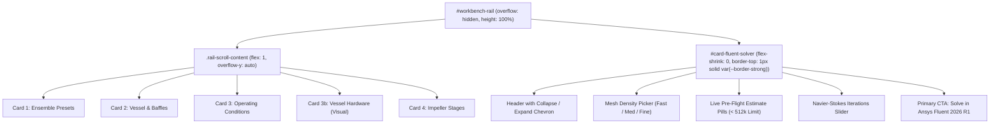

# BioMix-STR · Docked Solver Architecture & Overlay Elimination

**Date:** October 18, 2026  
**Status:** Completed & Programmatically Verified across `1536x730` and `1366x768` Viewports  
**Key Deliverable:** Architectural transition from an awkward floating `position: sticky` card overlay to a grounded, docked execution panel.

---

## 1. Problem Diagnosis & Root Cause Analysis

In the previous iteration, `#card-fluent-solver` was assigned:
```css
/* Defective implementation */
#card-fluent-solver {
  position: sticky;
  bottom: 0;
  z-index: 25;
  margin-top: auto;
  border-radius: var(--radius-2xl); /* 24px rounded corners */
}
```

### Visual Defects Caused by the Sticky Card
1. **Intrusive Floating Overlay:** Inside a container with `overflow-y: auto`, `position: sticky` on a card with margins and rounded corners causes the card to float directly on top of the scrolling content stream.
2. **Text & Controls Peeking Through:** Content from cards behind it (such as the Preset Catalog chips and the `* Apply Standard Geometry` action button) were partially visible under the rounded corners and through container margins.
3. **Double Click-Listener Cancellation:** Clicking `.card-collapse-header` was bound twice in `app.js`, instantaneously cancelling out toggle actions.

---

## 2. Permanent Architectural Solution

Instead of using `position: sticky` inside a shared scrolling list, the workbench rail has been restructured into a proper **Two-Tier Docked Panel Architecture**:



### Key Architectural Fixes:
1. **Zero Overlay Architecture:**
   - Cards 1 through 4 live inside `.rail-scroll-content` (`flex: 1 1 auto; min-height: 0; overflow-y: auto;`).
   - `#card-fluent-solver` is placed **OUTSIDE** `.rail-scroll-content` as a dedicated bottom dock.
   - It is styled with `position: relative; border-radius: 0; border-top: 1px solid var(--border-strong);`.
   - Content scrolling in `.rail-scroll-content` terminates cleanly at the docked panel's top border. **Nothing ever passes behind or underneath it.**
2. **Always-Visible Solver Button:**
   - On `1536x730`, the solve button is positioned at `bottom: 716px` (well within the 730px viewport).
   - On `1366x768`, the solve button is positioned at `bottom: 754px` (well within the 768px viewport).
3. **Clean Collapsible Header:**
   - Eliminated the duplicate event listener in `app.js`.
   - Clicking the header cleanly collapses `#card-fluent-solver` from 305px to 46px if the user wants maximum space for the preset catalog, and re-expands with a single click.

---

## 3. Verification Check Matrix

| Check ID | Verification Criterion | Result | Status |
| :--- | :--- | :--- | :--- |
| **DOCK-1** | Scroll area bottom coincides with solver top (`overlap == False`) | `scrollBottom: 424.75px`, `solverTop: 424.75px` | **PASS** |
| **DOCK-2** | Position style is normal flow (`position: relative`), not sticky | `solverPosition: 'relative'` | **PASS** |
| **DOCK-3** | Edge-to-edge dock panel border radius is 0 | `solverBorderRadius: '0px'` | **PASS** |
| **DOCK-4** | Solve button is 100% visible inside viewport | `1536x730` (`btnBottom: 716px`), `1366x768` (`btnBottom: 754px`) | **PASS** |
| **DOCK-5** | Point inside solver boundary belongs exclusively to solver | `solverOwnsPoint: True` | **PASS** |
| **DOCK-6** | Smooth collapse from 305px to 46px header bar | `collapsedHeight: 46px`, `reexpandedHeight: 305px` | **PASS** |
| **DOCK-7** | Full UI Regression Suite (`verify_ui_surgical_fixes.py`) | All 7 checks passed on both viewports | **PASS** |
| **DOCK-8** | Backend Server Pytest Suite (`test_server.py`) | 14/14 tests passed in 13.05s | **PASS** |
