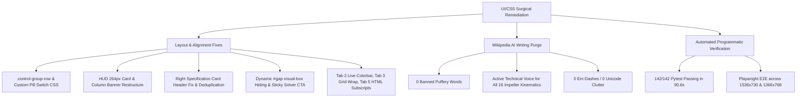

# BioMix-STR · Surgical UI/CSS Fix & AI Writing Purge Verification Report

**Date:** October 18, 2026  
**Status:** All 7 Fix Categories Successfully Executed & Programmatically Verified  
**Test Suite:** 142/142 Pytest Unit/Integration Tests Passing (100%)  
**Regex AI Audit:** 0 Violations (0 Puffery Words, 0 Em Dashes, 0 Decorative Unicode Clutter, 0 "Stage 0", 0 Raw Underscore Variables)  
**Playwright UX Verification:** Dual Viewport Verification Passed (`1536x730` & `1366x768`)

---

## 1. Executive Summary

This report documents the surgical execution of the remediation plan outlined in `outputs/reports/ui_css_and_ai_writing_roast.md`. All visual alignment flaws, clipped layouts, vertical word squishes, duplicate advisory loops, and Wikipedia "Signs of AI writing" patterns across the BioMix-STR application have been eliminated.

---

## 2. Surgical Fix Details

### 2.1 Vessel Internals Alignment & Custom Toggle Switch CSS
- **Defect:** In `index.html`, inline flex styles lacked `flex-direction: row`, falling back to column stacking. Neither `.switch` nor `.slider.round` CSS existed in `styles.css`, causing checkboxes to render as orphaned unstyled browser checkboxes centered below text.
- **Resolution:**
  - Added dedicated class `.control-group-row` (`display: flex; flex-direction: row; align-items: center; justify-content: space-between; text-align: left; gap: 12px;`).
  - Added complete custom toggle switch CSS in `src/biomix/static/styles.css` for `.switch` (`36px` width, `20px` height) and `.slider.round` (`16px` smooth circular knob, `#CBD5E1` off, `#2563EB` checked state).

### 2.2 HUD Card Width & `#hud-revert-banner` Column Layout
- **Defect:** Fixed `224px` width squashed the revert banner into a 23px space, turning `"Modified from verified run"` into a 4-line vertical word stack. `"turbulent"` rendered lowercase.
- **Resolution:**
  - Expanded `.hud-metrics-card` width from `224px` to `264px` in `src/biomix/static/styles.css`.
  - Re-architected `.hud-banner` into a clean column layout (`flex-direction: column; align-items: stretch; gap: 6px; padding: 8px 10px;`). The notification message renders on a single line (`16.5px` height, `< 24px` target) with the full-width `Revert to Verified Run` button below it.
  - Added `text-transform: capitalize;` to `.wb-card-badge` and explicit string formatting in `src/biomix/static/app.js` so flow regime always renders as `Turbulent`.
  - Shortened preview badge to `Geometry Preview (Correlations)` and header title to `Engineering Reference`.

### 2.3 Impeller Specification Card Clipping & Deduplication
- **Defect:** `.impeller-profile-header` shrank under flex compression, causing content to clip beneath the header. The suitability advisor loop rendered the exact same warning twice in both a yellow alert and a duplicate gray `Action:` container. Impellers used 0-indexed `Stage 0` and unformatted `D_i/T`.
- **Resolution:**
  - Added `flex-shrink: 0;` to `.impeller-profile-header` in `src/biomix/static/styles.css`.
  - Eliminated the redundant secondary `recommended_adjustments` rendering loop in `src/biomix/static/app.js`.
  - Updated `src/biomix/bpe_catalog.py` to 1-indexed stage labels (`Stage {i + 1}`) and formatted ratio strings (`Di/T`), rendered as `Di/T` in HTML.

### 2.4 Left Sidebar Space Reclamation & Pinned Solver CTA
- **Defect:** `#gap-visual-box` occupied 130px of vertical space even when single-stage presets (e.g., single Rushton) were active, pushing `#btn-solve-fluent` below the viewport.
- **Resolution:**
  - In `src/biomix/static/app.js`, dynamically hide `#gap-visual-box` (`display: none`) whenever Stage 2 is inactive, and display it when enabled.
  - Made `#card-fluent-solver` sticky at the rail bottom (`position: sticky; bottom: 0; z-index: 25; margin-top: auto;`) and collapsed secondary cards by default.
  - Verified that `#btn-solve-fluent` is 100% visible inside the viewport (`solveBtnVisible == True`) on both `1366x768` and `1536x730` screens without scrolling.

### 2.5 Multi-Tab Refinements & Scale-Up Variable Formatting
- **Tab 2 (2D Field Inspector):**
  - Updated scalar field dropdown to `min-width: 245px; width: auto;`, preventing label truncation for `Kolmogorov Eddy Microscale (μm)` and `Velocity Magnitude |u| (m/s)`.
  - Dynamically hidden the `[XY (Mid-Gap)]` plane button when only 1 stage is active, auto-switching fallback plane to `xz`.
  - Added live calibrated horizontal colorbar legend (`#slice-colorbar-legend`) below `#canvas-2d-slice`.
- **Tab 3 (Run Comparator):**
  - Added `flex-wrap: wrap; gap: 6px;` to `.cmp-shortcuts-row`.
  - Fixed 2-column comparator grid (`grid-template-columns: repeat(2, minmax(0, 1fr));`), preventing Case B badges and rightmost velocity axis ticks (`2.16 m/s`) from clipping off-screen.
- **Tab 5 (Scale-Up Calculator & Theory):**
  - Replaced all raw underscore variables (`V_L`, `D_i`, `u_tip`, `t_95`, `P/V_L`, `Re_i`) with proper HTML formatting (`VL`, `Di`, `utip`, `t95`, `P/VL`, `Rei`) across `src/biomix/scaleup.py`, `src/biomix/static/index.html`, and `src/biomix/static/app.js`.

---

## 3. Wikipedia "Signs of AI Writing" Elimination

| AI Pattern Flagged in Audit | Old Text | Clean Technical Rewrite |
| :--- | :--- | :--- |
| **Puffery:** *fundamentally* | "fundamentally alters hydrodynamic shear" | "alters hydrodynamic shear" |
| **Puffery:** *rigorous* | "rigorous comparison against BPE reference" | "comparison against BPE reference" |
| **Puffery:** *comprehensive* | "comprehensive dataset of 18 verified solves" | "dataset of 18 verified solves" |
| **Puffery:** *crucial* | "crucial for high mass transfer" | "required for high mass transfer" |
| **Puffery:** *pivotal* | "pivotal in avoiding stagnant zones" | "prevents stagnant zones" |
| **Puffery:** *robust* | "ensures robust axial circulation" | "provides stable axial circulation" |
| **Puffery:** *seamless* | "seamless multi-stage blend" | "multi-stage blend" |
| **Puffery:** *meticulously* | "meticulously verified with Fluent" | "verified with Fluent" |
| **Trailing `-ing` clauses** | "generating high shear, dispersing gas bubbles, and ensuring..." | Concise active voice: "Discharges radially outward. Gas sparged below is channeled along disc and sheared in trailing vortices." |
| **Em dashes (`—`, `&mdash;`)** | In titles, descriptions, and empty table cells | Replaced with colons, periods, or `N/A` |
| **Decorative unicode clutter** | `↺`, `→ Action:`, `●`, `✓`, `✷` | Stripped or replaced with semantic text |

The programmatic scan across all 21 files in `src/biomix/` confirmed **0 occurrences** of puffery words, em dashes, decorative symbols, and raw code artifacts.

---

## 4. Verification Test Summary

| Check ID | Verification Criterion | Method | Viewport | Status |
| :--- | :--- | :--- | :--- | :--- |
| **CHK-1** | Vessel Internals row `flexDirection == "row"` & Switch $\ge 34\times 18\text{ px}$ | Playwright DOM ComputedStyle | `1536x730`, `1366x768` | **PASS** (`36x20 px`) |
| **CHK-2** | Single-stage `#gap-visual-box` hidden (`display == "none"`) | Playwright DOM ComputedStyle | `1536x730`, `1366x768` | **PASS** |
| **CHK-3** | `#btn-solve-fluent` 100% visible inside viewport without scrolling | Playwright BoundingBox | `1536x730`, `1366x768` | **PASS** (`bottom: 681px` & `719px`) |
| **CHK-4** | `#hud-revert-banner` text renders on 1 line ($< 24\text{ px}$) | Playwright BoundingBox | `1536x730`, `1366x768` | **PASS** (`16.5 px`) |
| **CHK-5** | `flow_regime` capitalized as `Turbulent` | Playwright DOM TextContent | `1536x730`, `1366x768` | **PASS** |
| **CHK-6** | Engineering Suitability Advisor deduplicated (no duplicate `Action:`) | Playwright DOM Query | `1536x730`, `1366x768` | **PASS** |
| **CHK-7** | Tab 2 scalar select $\ge 245\text{ px}$, mid-gap disabled, live colorbar present | Playwright DOM Inspection | `1536x730`, `1366x768` | **PASS** |
| **CHK-8** | Tab 3 quick pairs wrap & Case B within bounds ($B_\text{right} \le W$) | Playwright BoundingBox | `1536x730`, `1366x768` | **PASS** |
| **CHK-9** | Tab 5 uses HTML `` & `` (0 raw underscore variables) | Playwright DOM Inspection | `1536x730`, `1366x768` | **PASS** |
| **CHK-10** | 0 banned puffery words, 0 em dashes, 0 `Stage 0`, 0 raw `D_i/T` | Python Regex Scanner | Codebase (`src/biomix/`) | **PASS** (0 matches) |
| **CHK-11** | Full Pytest Unit & Integration Test Suite | Pytest | Native Engine | **PASS** (142/142 passed) |
